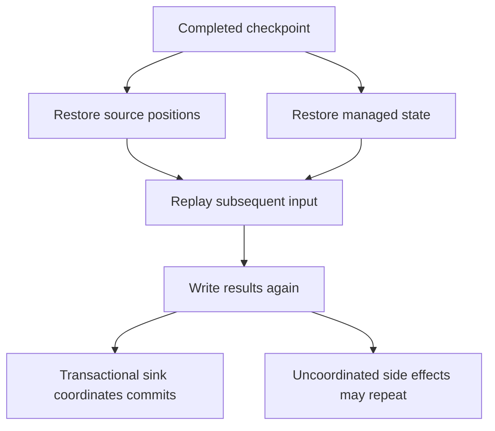

---
tags:
  - platform-engineering
---

# Apache Flink

Apache Flink is a distributed processing engine for bounded data (a dataset that ends) and unbounded data (a stream that keeps arriving). Its main strength is **stateful stream processing**: continuously calculating results that depend on earlier events, with support for event time and recovery after failures.

Think of a fraud rule that asks, "Has this account made five purchases in two minutes?" Reading each purchase independently cannot answer that. Something must remember recent purchases per account, decide which two minutes count, and recover that memory if a worker crashes. Flink provides the machinery for those responsibilities.

Read this guide in order on a first pass. The goal is to explain why a problem needs state and time, trace a small job, and describe what happens when data is late or a worker fails. Backend tuning and deployment details can follow once that model is clear.

## Quick Refresh

```text
source -> transformations -> keyed state / windows -> sink
```

| Concept | Meaning |
| --- | --- |
| Source / sink | Where a job reads input / writes results |
| Operator | A processing step, such as filtering, joining, or aggregating |
| State | Information retained between events, such as a running total |
| `keyBy` | Routes records with the same key to the same parallel instance of a downstream operator |
| Event time | When an event happened, according to its timestamp |
| Watermark | A signal of progress in event time; used to trigger event-time work |
| Window | A grouping of events into a finite interval or activity session |
| Checkpoint | A consistent snapshot used for failure recovery, when checkpointing is enabled |
| Savepoint | An explicitly triggered snapshot used for planned operations such as upgrades |

The three central questions are: **What must the job remember? Which clock defines the answer? What must stay consistent after a failure?**

## Why and When to Use Flink

Flink is useful when results need to change continuously and each result depends on more than the current record. Examples include live sales totals, sensor monitoring, joining orders with payments, and detecting sequences of suspicious activity. Its value is combining those calculations with distributed state management and recovery, rather than requiring each application to build them separately. See [Flink application categories](https://flink.apache.org/what-is-flink/flink-applications/).

For example, an order/payment join must remember an order until its payment arrives. It also needs a rule for orders that never receive a payment. A time limit bounds that state and defines when an unmatched order can be reported. This is a business decision as well as a memory decision.

Choose a tool by the computation and freshness requirement:

| Situation | Reasonable starting point |
| --- | --- |
| Validate each message and call an API, with little cross-event state | An ordinary consumer or service may be simpler |
| Maintain Kafka-focused aggregates inside an existing application | Compare Kafka Streams with Flink; both provide stateful processing |
| Combine streams, event-time windows, and substantial managed state | Flink is a strong candidate |
| Produce a daily report where minutes or hours of delay are acceptable | A scheduled SQL query or batch pipeline may be enough |

Kafka and Flink often work together. **Kafka retains and transports events; Flink computes over them.** A Kafka consumer group distributes reading, but does not by itself supply windowing, distributed snapshots, or consistent recovery of application state. [Kafka Streams](https://kafka.apache.org/43/streams/) is a processing library, so it is a different comparison from a hand-written consumer.

The cost is operating another runtime: workers, checkpoint storage, connectors, state capacity, monitoring, and safe upgrades. Low processing latency also does not guarantee immediate visible results; a window may wait for a watermark, and a transactional sink may wait for a checkpoint to commit.

Flink also supports batch execution over bounded inputs. The final answer can match streaming execution, but scheduling, output timing, and failure recovery differ. Batch mode is not simply a streaming job with periodic checkpoints added. See [batch and streaming execution](https://nightlies.apache.org/flink/flink-docs-stable/docs/dev/datastream/execution_mode/).

## How Data Flows Through a Flink Job

A job is a graph of sources, operators, and sinks. A source reads events, operators transform them and update state, and a sink publishes results for applications or downstream jobs.

Stateless work needs only the current event: reject an invalid reading or convert Celsius to Fahrenheit. Stateful work needs previous information: calculate a rolling average, detect duplicate event IDs, or match an order with a later payment. Windows are one way to organise state; a running total or a custom timer does not require a window.

There are two useful starting points for writing jobs. **Flink SQL and the Table API** suit relational operations such as filtering, grouping, and joining. A streaming query keeps processing changes instead of finishing after one response. **The DataStream API** suits custom event logic, explicit state, and timers. Both use the Flink runtime; SQL does not remove the need to understand time and recovery. See [Flink's API levels](https://nightlies.apache.org/flink/flink-docs-stable/docs/concepts/overview/#flinks-apis).

Consumers usually read persisted results from a database, Kafka topic, or files. Define the output contract: is each result a new event, a replacement for a previous aggregate, or a correction? That determines whether the sink and its consumers can interpret the calculation correctly.

## Job Architecture

The **JobManager** coordinates scheduling, checkpoints, and recovery. **TaskManagers** execute the work. An operator can run as several parallel subtasks; different operators can have different parallelism. Task slots provide execution capacity, and slot sharing means a slot is not necessarily dedicated to one operator. Compatible adjacent operators can be chained into one task to avoid network overhead. See [Flink architecture](https://nightlies.apache.org/flink/flink-docs-stable/docs/concepts/flink-architecture/).

`keyBy(accountId)` repartitions records so each account's downstream state has one owner at a time. Records can travel across the network to reach that owner; its placement need not match the original Kafka partition. Increasing parallelism spreads different keys across more subtasks, but does not split the work for one unusually busy key.

The practical implication is that scaling depends on the shape of the data. A million evenly distributed accounts may scale well; one account producing most of the traffic can create a bottleneck.

## Stateful Processing

Keyed state belongs to a key, such as one account's recent purchases. Operator state belongs to a parallel operator instance rather than a business key. Use Flink-managed state when that information must participate in recovery; an ordinary local variable is not automatically checkpointed.

State also needs a lifetime. Windows eventually clean up their state, while custom state needs explicit cleanup or a suitable time-to-live policy. Keeping every event ID forever for deduplication creates an ever-growing job. Expiring IDs saves capacity, but duplicates arriving after expiry will no longer be recognised. See [working with state](https://nightlies.apache.org/flink/flink-docs-stable/docs/dev/datastream/fault-tolerance/state/).

The **state backend** manages the working state. Heap-based state offers fast object access but consumes JVM memory and can create garbage-collection pressure. Embedded RocksDB can hold state beyond the available heap using local disk, at the cost of serialization and storage overhead; it supports incremental checkpoints when configured. Neither removes the need to budget memory and disk. See [state backends](https://nightlies.apache.org/flink/flink-docs-stable/docs/ops/state/state_backends/).

**Checkpoint storage** holds recovery snapshots, normally in durable shared storage for production. Working state on a worker's local disk is not enough to recover if that machine disappears.

## Event Time and Watermarks

Event time answers "When did this happen?" Processing time answers "When did this operator process it?" A purchase made at 10:02 but delivered at 10:08 belongs to the 10:00–10:05 event-time bucket. Using processing time would place it in a later bucket. Event time supports calculations based on business timestamps during delays and replay, provided the timestamps and late-data policy are appropriate. See [time in Flink](https://nightlies.apache.org/flink/flink-docs-stable/docs/concepts/time/).

A stream never announces that all events for a period have arrived. A **watermark** supplies a progress estimate so the job can stop waiting. A common bounded-out-of-orderness strategy derives it from the largest timestamp observed minus a configured delay. It is an assumption about arrivals, not proof that older events cannot appear.

An operator advances using the minimum watermark of its active inputs. Watermarks are tracked through partitions and parallel inputs, **not separately for each sensor or account key**. One slow input can therefore delay windows for many keys. Idle-input detection excludes inactive inputs from that minimum; an input returning later can still deliver late data. See [watermark generation and idleness](https://nightlies.apache.org/flink/flink-docs-stable/docs/dev/datastream/event-time/generating_watermarks/).

With the default event-time trigger, a window fires when the watermark reaches its last included timestamp. For `[10:00, 10:05)`, that is just before 10:05 at millisecond precision. A larger watermark delay waits longer for out-of-order events; a smaller delay gives earlier answers with more chance of late arrivals. Wall-clock time alone does not advance event time on an inactive unbounded stream.

## Windows

Choose a window from the question being asked:

| Window | Example question | Consequence |
| --- | --- | --- |
| Tumbling | How many purchases occurred in each five-minute bucket? | Non-overlapping intervals; each event belongs to one bucket |
| Sliding | How many purchases occurred in the last ten minutes, updated every minute? | Overlapping intervals; an event contributes to several windows |
| Session | What happened during a visit, separated from other visits by inactivity? | Gap-based groups; arriving events can merge sessions |

Two settings are easy to confuse. **Watermark delay** affects when event time advances and a window first fires. **Allowed lateness** in DataStream windows retains state after that firing so late events can produce updated results. It does not delay the first firing. Once the cleanup threshold is reached, events for that window are dropped or routed to a configured late-data side output. The default allowed lateness is zero. See [window lifecycle and late data](https://nightlies.apache.org/flink/flink-docs-stable/docs/dev/datastream/operators/windows/).

If an answer can be updated, its consumers must understand corrections. A dashboard row keyed by `(sensorId, windowStart)` can replace the earlier average; treating both versions as independent readings would double-count them.

## Worked Example: Five-Minute Sensor Averages

Suppose a dashboard needs average temperature per sensor for each five-minute interval. Readings contain `sensorId`, `eventTime`, and `temperature`. Devices sometimes buffer data, so arrival order differs from event-time order.

The pipeline is:

```text
Kafka readings -> validate -> assign timestamps/watermarks -> keyBy(sensorId)
              -> 5-minute tumbling window -> average -> dashboard table
```

For this DataStream example, use a one-minute watermark delay and two minutes of allowed lateness with the default event-time trigger. Retain a sum and count per sensor/window, rather than all readings. A reading at 10:01 with value 20 and a reading at 10:04 with value 24 give sum 44, count 2, and average 22 for `[10:00, 10:05)`.

When the window operator's watermark advances beyond 10:05, it emits average 22. A later arrival with event time 10:03 and value 28 can still update the retained window before cleanup: sum 72, count 3, average 24. The sink must replace the earlier result for that sensor/window. Events arriving after cleanup go to a configured late-data side output for a separate correction process.

Enable checkpoints and choose the sink's recovery behaviour explicitly. A stable output key is useful, but recovery-safe database writes also require deterministic replacement values and suitable ordering or version handling; an upsert key alone does not make every write exactly-once.

This design makes the trade-off concrete: wait briefly before the first answer, accept corrections for longer, then stop retaining window state. The delay and correction period should follow observed device behaviour and the dashboard's requirements.

## Checkpoints and Exactly-Once

When enabled, checkpoints capture source positions and managed state consistently. Barriers travel through the graph to mark the snapshot boundary. Aligned checkpoints coordinate input boundaries; snapshot data is persisted asynchronously. After a failure, Flink restores the latest completed checkpoint and replays input after its recorded positions. See [fault tolerance](https://nightlies.apache.org/flink/flink-docs-stable/docs/learn-flink/fault_tolerance/).

The recovery relationship is:



**Exactly-once state consistency does not mean code executes only once.** Replayed events can execute again; restoring state prevents their earlier, uncheckpointed state changes from being counted twice. This needs an appropriate checkpoint mode and a replayable source whose retained data covers recovery.

End-to-end output guarantees depend on the sink. The Kafka sink's exactly-once mode uses transactions coordinated with checkpoints, and consumers must use `read_committed` to see only committed output. This delays visibility until commit. Checkpointing and the delivery mode must be configured; the Kafka sink's default delivery guarantee is `NONE`. See [Kafka sink fault tolerance](https://nightlies.apache.org/flink/flink-docs-stable/docs/connectors/datastream/kafka/#fault-tolerance).

A plain database insert or an email sent inside an operator can repeat after replay. Idempotent writes can make repetitions harmless for a particular output contract, but do not make arbitrary external actions transactional. Duplicate business events already present in the source also need a separate deduplication rule.

A **savepoint** supports planned upgrades, moves, and rescaling. Restoring into changed code requires compatible state and stable operator IDs; a snapshot does not make every change safe. See [savepoints and operator IDs](https://nightlies.apache.org/flink/flink-docs-stable/docs/ops/state/savepoints/).

## Common Failure Modes

**Delayed results despite a running job.** Check source lag and input watermarks before assuming the window calculation is broken. A slow or idle input can hold back event time; marking idle inputs helps only when inactivity is the cause.

**Backpressure mistaken for insufficient source capacity.** A slow sink or operator prevents upstream stages from sending more data. The slowdown propagates towards the source, and Kafka lag can grow. Inspect busy and backpressured subtasks and downstream throughput before adding workers. See [monitoring backpressure](https://nightlies.apache.org/flink/flink-docs-stable/docs/ops/monitoring/back_pressure/).

**More workers without more throughput.** Check key distribution. One hot key remains owned by one subtask; changing the key or splitting and recombining aggregates is only valid if it preserves the required calculation.

**State growth without a retention policy.** Unbounded joins and deduplication can accumulate state indefinitely. Define when unmatched records or remembered IDs expire, and explain what correctness guarantee that expiry gives up.

**Correct internal state but duplicate or stale output.** Check the sink contract, delivery mode, and handling of updated window results. Replay, business duplicates, and late corrections are different causes and require different responses.

**An upgrade loses state or cannot restore.** Keep operator IDs stable, check state compatibility, and verify restoration before replacing a running job. For recovery health, monitor checkpoint failures, duration, and the age of the latest completed checkpoint; a job can be processing while its recovery point becomes increasingly old.

## Worked Prediction: The Late Sensor Reading

Use five-minute event-time tumbling windows with the default trigger. The window operator's **current input watermark is 10:03:30**. At wall-clock 10:06, a reading for sensor `A42` arrives with event time 10:03:00. Which window receives it, and has that window fired?

**Expected result:** it joins `[10:00, 10:05)`, which has not fired. Its timestamp is behind the watermark, but the window's firing threshold is still ahead of the watermark. It can therefore contribute to that window. Wall-clock 10:06 does not determine the outcome.

Now suppose the watermark is 10:05:30 and a reading with event time 10:04:45 arrives. Compare zero allowed lateness with two minutes of allowed lateness.

**Expected result:** with zero allowed lateness, the window has fired and been cleaned up; the reading is dropped or sent to a configured late-data side output. With two minutes of allowed lateness, the state is still retained and the default trigger emits an updated result. Cleanup occurs around watermark 10:07, not two wall-clock minutes after the first result.

Finally, suppose two active inputs have watermarks 10:08 and 10:03. Does `[10:00, 10:05)` fire?

**Expected result:** no. The operator uses the minimum, 10:03. Excluding the second input after it becomes idle can allow progress; merely adding more keys or advancing the first input does not.

## Interview Questions

> [!question] Interview Questions
> - When would you choose Flink over an ordinary Kafka consumer, Kafka Streams, or a scheduled batch query, and what operational cost would you accept?
> - How do event time, watermarks, and allowed lateness determine the first result and later corrections for a five-minute sensor window?
> - What happens after a worker crashes, and why can an exactly-once Flink job still send an email twice?
> - Why might doubling a job's parallelism fail to improve throughput, and how would you distinguish a hot key from a slow sink?

## Answer Notes

1. Choose Flink when continuous results need coordinated state and time across a distributed pipeline. A simple consumer may suit independent records, Kafka Streams merits comparison for Kafka-focused application processing, and batch may meet a relaxed freshness requirement. Justify the choice with the required calculation, latency, state size, and the cost of operating the runtime.

2. Event time assigns the reading to its business-time interval. The minimum active-input watermark controls the first default event-time firing. Watermark delay trades timeliness for completeness; allowed lateness retains window state for corrections after firing. Corrections need replacement or changelog semantics downstream, and a policy for events arriving after cleanup.

3. Restore source positions and managed state from the latest completed checkpoint, then replay subsequent input. Exactly-once applies to consistent state effects, not a single execution of each event. An email is outside that snapshot and can repeat; use a suitable external idempotency mechanism or a coordinated sink for the required effect.

4. Parallelism spreads different keys, but one hot key still has one state owner. Compare per-subtask load and key distribution: concentrated busy work suggests skew, while backpressure upstream of a low-throughput sink suggests a downstream bottleneck. Improve the constrained stage; only split a key if the calculation can be combined correctly.

## Official References

Start with the tutorials, then use the concept pages linked above to investigate particular mechanisms. Select documentation and connector versions compatible with the Flink release you run.

- [Learn Flink](https://nightlies.apache.org/flink/flink-docs-stable/docs/learn-flink/overview/) — the guided learning path
- [First steps](https://nightlies.apache.org/flink/flink-docs-stable/docs/getting-started/local_installation/) — run a local example and inspect a job
- [Flink SQL tutorial](https://nightlies.apache.org/flink/flink-docs-stable/docs/getting-started/quickstart-sql/) — start with relational stream processing
- [DataStream API tutorial](https://nightlies.apache.org/flink/flink-docs-release-2.3/docs/getting-started/datastream/) — follow a code-based pipeline (Flink 2.3 documentation)
- [Streaming analytics](https://nightlies.apache.org/flink/flink-docs-stable/docs/learn-flink/streaming_analytics/) — explore event time, watermarks, and windows

## Related Guides

- [Apache Kafka](./kafka.md) — retained event logs, partitions, replay, and the source/sink boundary for many Flink jobs
- [Publish/Subscribe](./pub-sub.md) — how events reach consumers, before adding stateful processing
- [Kubernetes](./kubernetes.md) — orchestration concepts relevant to operating a Flink cluster on Kubernetes

Return to [Platform Engineering](./README.md).
