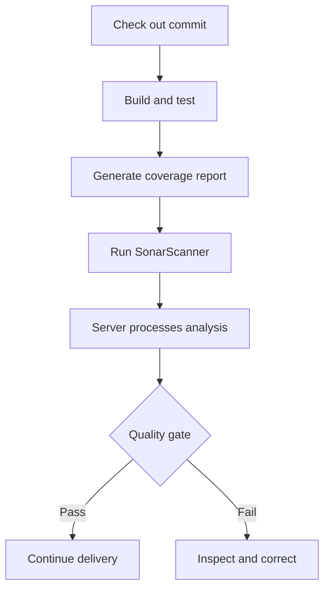

---
tags:
  - quality-engineering
---

# SonarQube

SonarQube analyses source code for reliability, security, and maintainability issues and brings the findings into code review and delivery. Think of it as an analysis service plus a policy decision: a scanner collects evidence, the server processes it, and a quality gate evaluates the result.

## Quick Refresh

Analysis belongs alongside builds and tests in the delivery flow:



| Concept | Purpose |
| --- | --- |
| SonarScanner | Analyses the checked-out project and submits a report for server processing |
| Quality profile | Selects the analysis rules for a particular language |
| Quality gate | Defines pass/fail conditions on analysis measures |
| New code definition | Establishes which additions or changes are evaluated as new code |
| Coverage import | Supplies execution evidence produced by a separate coverage tool |
| Security hotspot | Flags security-sensitive code that needs contextual review |

SonarQube Server is self-managed; SonarQube Cloud is the hosted service. SonarQube Community Build and commercial offerings have different capabilities. Check the documentation for the deployed product and version before assuming language support, branch analysis, or pull-request integration is available. [SonarQube Server overview](https://www.sonarsource.com/products/sonarqube/server/).

## Quality Profiles, Gates, and New Code

A quality profile answers “which rules analyse this language?” A quality gate answers “does this analysis satisfy our acceptance policy?” Enabling a rule does not by itself make every finding a blocking condition; the gate determines which measures and thresholds affect its status. [Quality profiles](https://docs.sonarsource.com/sonarqube-server/quality-standards-administration/managing-quality-profiles/introduction), [quality gates](https://docs.sonarsource.com/sonarqube-server/2026.1/quality-standards-administration/managing-quality-gates/introduction-to-quality-gates).

For an established codebase, a gate focused on new code lets the team prevent deterioration while addressing older findings separately. Define that baseline deliberately: a reference branch, previous version, or other supported definition changes what is considered new. In pull-request analysis, new code is the change relative to the target branch. [New code definitions](https://docs.sonarsource.com/sonarqube-server/2026.1/user-guide/about-new-code).

For example, a team might require a minimum coverage measure on new code and no new issues of specified kinds. Treat these as agreed project policy; inspect the actual gate rather than memorising assumed default thresholds. Keep ownership of existing high-risk findings even when the new-code gate passes.

## Worked Example

Assume a JavaScript application has `src/` and `tests/` directories, a committed npm lockfile, and an `npm run test:coverage` script that runs tests once and emits LCOV at `coverage/lcov.info`. The report generator and coverage dependencies must already be configured. This example is for a separate application, not this Markdown handbook.

Create `sonar-project.properties` at the application root:

```properties
sonar.projectKey=checkout-service
sonar.sources=src
sonar.tests=tests
sonar.sourceEncoding=UTF-8
sonar.javascript.lcov.reportPaths=coverage/lcov.info
```

Provision the corresponding project on a reachable SonarQube Server. Install a compatible SonarScanner CLI and supply `SONAR_HOST_URL` and a project analysis token as `SONAR_TOKEN` through the environment or CI secret store. Keep tokens out of committed configuration. Run from the application root; on Windows use `sonar-scanner.bat` for the scanner command. [SonarScanner CLI](https://docs.sonarsource.com/sonarqube-server/analyzing-source-code/scanners/sonarscanner).

```sh
# Execute these as successive CI steps that stop on failure.
npm ci
npm run test:coverage
sonar-scanner -Dsonar.qualitygate.wait=true -Dsonar.qualitygate.timeout=300
```

The test step creates the report before scanning. SonarQube imports coverage; it does not execute the tests or generate their coverage report. Confirm the scanner found the report and resolved its file paths. This LCOV property applies to both JavaScript and TypeScript; other languages use their own supported report formats and parameters. [JavaScript/TypeScript coverage](https://docs.sonarsource.com/sonarqube-server/analyzing-source-code/test-coverage/javascript-typescript-test-coverage).

The wait flag makes the scanner poll for the processed quality-gate result and fail the step if the gate fails. Without an explicit gate check, successful report submission can finish before that decision exists. A timeout is a failure to obtain the decision within the allotted time, not evidence of a code defect. [Quality-gate parameters](https://docs.sonarsource.com/sonarqube-server/analyzing-source-code/analysis-parameters/parameters-not-settable-in-ui).

## Interpreting Findings and Coverage

A security hotspot identifies code whose safety depends on context. Review its use, inputs, protections, and deployment assumptions before deciding whether it needs a fix. A vulnerability finding represents a detected security problem; investigate and remediate it rather than assuming hotspot review and vulnerability handling are interchangeable. [Security hotspots](https://docs.sonarsource.com/sonarqube-server/2026.1/user-guide/security-hotspots).

Coverage records execution, not assertion quality. A test can execute a calculation without checking the answer. SonarQube also distinguishes line coverage, condition coverage, and its combined coverage measure; inspect the metric named in the gate before comparing percentages from different tools. [Metric definitions](https://docs.sonarsource.com/sonarqube-server/user-guide/code-metrics/metrics-definition).

Use static analysis with behavioural tests, human review, and other security checks appropriate to the application. A passing gate supports a delivery decision but does not prove correct requirements, safe authorisation, or production reliability.

## Common Failure Modes

**Publishing without enforcement:** a scan uploads successfully, but CI never checks the final gate. Make the gate result a required merge check or an explicit dependency of delivery. Preserve the commit identity so the decision applies to the artifact being promoted.

**Missing coverage evidence:** tests pass locally, but CI runs the scanner before report generation or in another workspace. Inspect report existence, format, paths, and import logs before changing thresholds. Passing test-execution reports and coverage reports provide different evidence. [Coverage overview](https://docs.sonarsource.com/sonarqube-server/analyzing-source-code/test-coverage/overview).

**Gaming the policy:** broad source exclusions, weakened rules, or casually dismissed findings can produce a green dashboard without improving the code. Review configuration changes and record a concrete justification when a finding is accepted or judged a false positive.

**Misidentifying new code:** missing target-branch information or an unsuitable baseline can distort the assessment. Follow the scanner's checkout requirements, retain the required Git history, and confirm the comparison branch. [Pull-request analysis setup](https://docs.sonarsource.com/sonarqube-server/10.8/analyzing-source-code/pull-request-analysis/setting-up-the-pull-request-analysis).

**Giving untrusted code credentials:** a pull-request build can execute project-controlled scripts. Restrict which execution paths receive the analysis token, grant only needed permissions, and investigate authentication or server failures separately from gate rejection.

## Worked Prediction

Assume a custom gate requires at least 80% coverage on new code, the small-change coverage exemption does not apply, and every other condition passes. Tests succeed, the uploaded analysis reports 60% new-code coverage, and the scanner runs without a gate wait or any later gate check. Can a pipeline that deploys after a successful scanner exit continue?

**Check your reasoning:** Yes. Successful upload does not establish the final gate result, so this pipeline can continue even though the server subsequently marks the gate failed. With `sonar.qualitygate.wait=true`, successful server processing within the timeout returns a failing scanner step for this gate, and a delivery job that requires that step to pass is blocked.

For a second attempt, the server remains unavailable until the wait times out. CI should stop with an unresolved analysis outcome; diagnose connectivity or processing availability rather than reporting that the code breached the coverage threshold. Define how infrastructure failures are retried without silently bypassing the required decision.

## Interview Questions

> [!question] Interview Questions
> - How do a quality profile, a quality gate, and a new code definition affect an analysis differently?
> - Why can tests pass while SonarQube reports missing coverage or a failed coverage condition?
> - What happens when report submission succeeds but CI does not wait for or require the quality-gate result?
> - How would you investigate a security hotspot, and why does a passing gate still require human review?

## Answer Notes

1. The profile selects language rules, the gate evaluates acceptance conditions, and the new code definition sets the change baseline. Check all three when a rule appears absent or the gate evaluates an unexpected scope.

2. Test success, coverage generation, and coverage import are separate steps. Verify the report exists before scanning, uses the supported format, and maps to analysed files; then inspect the particular gate measure. Executed code can still have weak assertions.

3. CI can continue before the server evaluates the analysis, including when the final gate fails. Wait for the gate or require its final status through the platform integration, and make merge or delivery depend on that result for the relevant commit.

4. Read the security-sensitive operation in context, trace inputs and protections, and record whether a fix is required. Static rules and configured thresholds cannot establish every business rule, trust boundary, or runtime property; reviewers and tests supply additional evidence.

## Official References

- [SonarQube Server documentation](https://docs.sonarsource.com/sonarqube-server)
- [Quality profiles](https://docs.sonarsource.com/sonarqube-server/quality-standards-administration/managing-quality-profiles/introduction)
- [Quality gates](https://docs.sonarsource.com/sonarqube-server/2026.1/quality-standards-administration/managing-quality-gates/introduction-to-quality-gates)
- [SonarScanner CLI](https://docs.sonarsource.com/sonarqube-server/analyzing-source-code/scanners/sonarscanner)
- [Coverage reporting](https://docs.sonarsource.com/sonarqube-server/analyzing-source-code/test-coverage/overview)

## Related Guides

- [Software Testing](./testing.md) — choose behavioural evidence that complements static analysis.
- [Test Runners and Assertion Libraries](./test-runners.md) — generate trustworthy test results before importing coverage.
- [Code Review](../engineering-foundations/code-review.md) — assess context, contracts, and findings that need human judgement.
- [GitHub Actions](../platform-engineering/ci-cd/github-actions.md) — make analysis and gate status dependencies of delivery.
- [Jenkins](../platform-engineering/ci-cd/jenkins.md) — orchestrate analysis, credentials, reports, and delivery stages.

Return to [Quality Engineering](./README.md).
